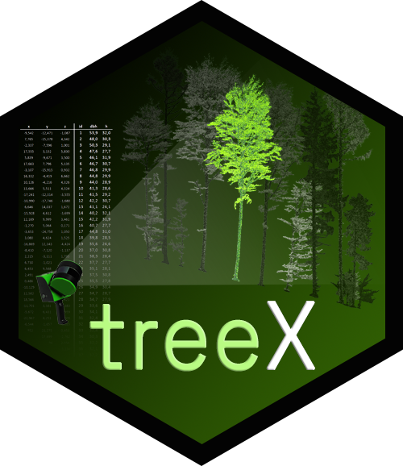

# treeX 

**R-package for individual tree extraction from ground-based point clouds.**

The functions in treeX were developed to analyze ground-based LiDAR data (PLS, MLS, TLS) from forest plots. 
It provides a modular framework for ground removal (including the generation of vertical slices), individual tree detection (via density clustering), instance segmentation (via iterative region-growing), and individual tree measurement (crown features are derived via alpha-hulls). 

Automatically derived parameters for diameter at breast height, tree height and crown basal height were benchmarked with conventional measurements in forest inventory (with a root mean square error of less than 2 cm dbh and 2 m height). See the citation section for more information.  

The package and all its functions were developed at the Institute of Forest Growth (WAFO), BOKU University, Vienna. 

A sample workflow can be found in the script "WORKFLOW_sample.R". 

# Installation

treeX runs on Windows, macOS (Intel and Apple Silicon) and Linux. The former
precompiled binary (edc) has been replaced by C++ source code that is compiled
during installation, so the package now builds natively on every platform.

Before first use, make sure to also run the script "_install_for_treeX.R" once for installing the required libraries. 

       source("https://raw.githubusercontent.com/anditockner/treeX/refs/heads/main/_install_for_treeX.R")

After getting all dependencies, install the package from GitHub via

       pak::pak("anditockner/treeX")

### macOS notes

* Install the Apple command line tools once (needed to compile the small C++
  routine shipped with treeX): `xcode-select --install`
* For interactive 3D plots the `rgl` package uses [XQuartz](https://www.xquartz.org/).
* Parallel processing works out of the box via a forked `doParallel` backend
  (`doMC` is no longer required).
* The optional `TreeLS` package (archived on CRAN) is **not** required on any
  platform any more; voxel thinning falls back to `lidR` automatically.
* The connected-components step and the `openColoredLAZ()` viewer use
  [CloudCompare](https://www.cloudcompare.org/), which is found automatically
  at `/Applications/CloudCompare.app` (install it from the website or via
  `brew install --cask cloudcompare`).

The software generates a folder structure given in the path specified in dirPath. 
All files will be renamed according to a file identifier specified in fileFinder. 
The input file is specified in LASfile. 

# Main Functions

* preparing folder structure with pre-processing of point cloud and creating ground model

       extractVegetation(LASfile, fileFinder)

* detecting tree positions and measuring diameter at 1.30 m (DBH)

       clustSplit(fileFinder)

* instance segmentation starting from list defining tree DBH positions

       crownFeel(fileFinder)

* calculating individual tree metrics (height, crown projection area, crown hull volume)

       computeTreeParams(fileFinder)

# Citation

For citing this methodology and for more details on the implementation, please refer to following paper

Tockner et al. 2022: Automatic tree crown segmentation using dense forest point clouds from Personal Laser Scanning (PLS)

https://doi.org/10.1016/j.jag.2022.103025

# Credits and macOS adaptation

treeX was created and is maintained by **Andreas Tockner** (Institute of
Forest Growth — WAFO, BOKU University, Vienna). The original repository is
<https://github.com/anditockner/treeX>; all scientific methodology, the
processing pipeline and the original implementation are his work. Please cite
the paper above when using this software.

This version contains a **macOS adaptation** contributed by
**Antonio Guoron** ([@antoniogrn](https://github.com/antoniogrn)),
which makes the package installable and runnable on macOS (Intel and Apple
Silicon) while remaining fully compatible with Windows and Linux:

* the former precompiled `edc` binary is replaced by C++ source
  (vendored from the GPL package *edci*) compiled during installation,
* a cross-platform `doParallel` backend replaces the `doMC` dependency,
* `TreeLS` (archived on CRAN) is optional, with an automatic `lidR` fallback,
* CloudCompare integration and file paths work on all three platforms.

The macOS adaptation was developed with the assistance of **Claude Fable 5**
(Anthropic's AI model), which analyzed the codebase, ported the native code
and implemented the cross-platform changes under Antonio Guoron's direction.

See `PORTING_NOTES_macOS.md` for the complete list of changes and
`INSTALL_macOS_RStudio.md` for step-by-step macOS installation instructions.
